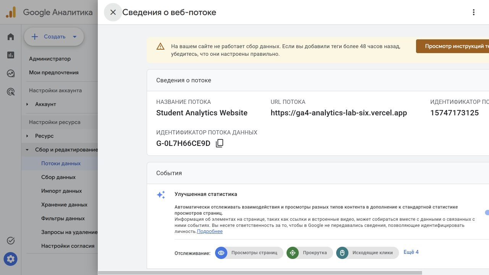
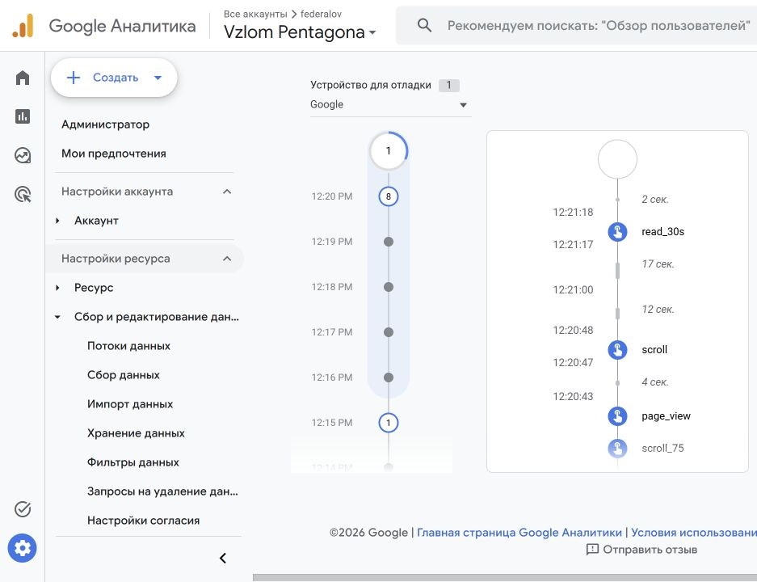

# Домашняя работа № 3 · Тег на сайте и GA4

ОП.03 «Информационные технологии»

Автор: Паюсов Семён

Группа: РПО 2\25

Дата проверки: 21.10.2026

## Ресурс и публикация

| Поле | Значение |
|---|---|
| Репозиторий | https://github.com/4youmans/ga4-analytics-lab |
| Сайт | https://ga4-analytics-lab-six.vercel.app |
| Публикация | Vercel: успешная публикация b70113f; исправление отладки ee86737 отправлено в main |
| Analytics Account | federalov · 407359702 |
| Property | Vzlom Pentagona · 553374022 |
| Web stream | Student Analytics Website · 15747173125 |
| Website URL | https://ga4-analytics-lab-six.vercel.app |
| Measurement ID | G-0L7H66CE9D |
| Enhanced Measurement | Включено |
| Страницы с одним тегом | index.html, about.html, contacts.html, guide.html |

Предупреждение потока о сборе данных за последние 48 часов на момент снимка ещё отображалось. Фактическое поступление событий проверено отдельно в DebugView; предупреждение не скрывалось.

## Проверка событий

21.10.2026 в DebugView получены page_view, nav_click, utm_visit, cta_click, scroll_75 и read_30s. Отладка включается только ссылкой с debug_mode=true; обычный визит не передаёт параметр debug_mode. Проверка кода: tests/analytics.test.cjs.

## Источник перехода

Проверочная ссылка: https://ga4-analytics-lab-six.vercel.app/?debug_mode=true&utm_source=telegram&utm_medium=social&utm_campaign=lesson07

В параметрах события utm_visit подтверждены telegram / social / lesson07 и landing_page=/. Это проверка параметров события. Источник сеанса в обработанном отчёте проверяется отдельно.

## Обработанные данные

На главной GA4 за 14–20 октября показаны 1 активный пользователь, 25 событий, 0 ключевых событий, 1 новый пользователь. Карточка сеансов показывает 1 Direct. Это малый объём тестовых посещений; он не позволяет сравнивать эффективность рекламных источников. Сегодняшние тесты в завершённый период не входят. Отдельный кадр проверки обнаружения тега и подробный отчёт по источникам ещё нужны.
