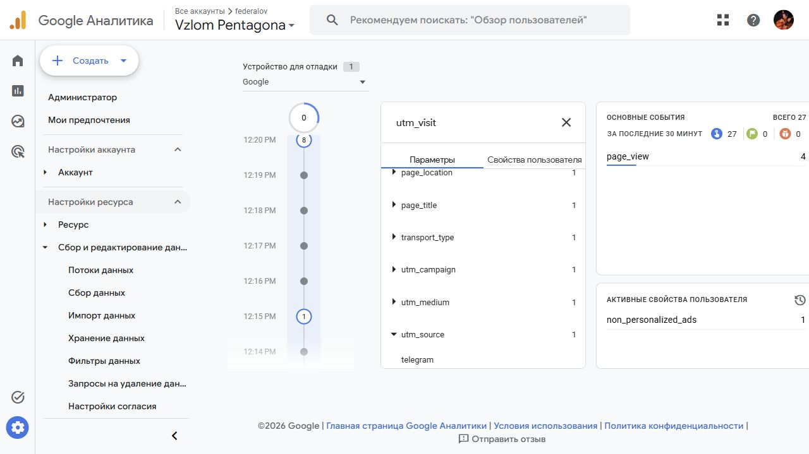
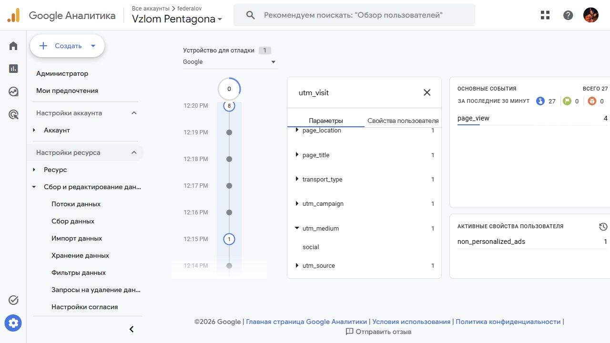
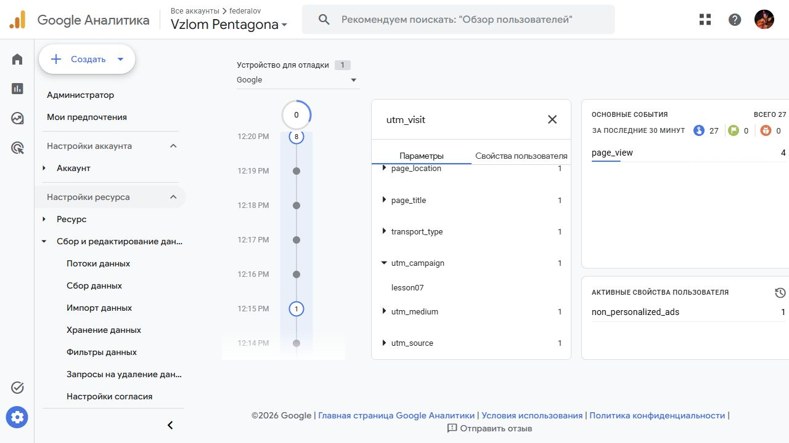
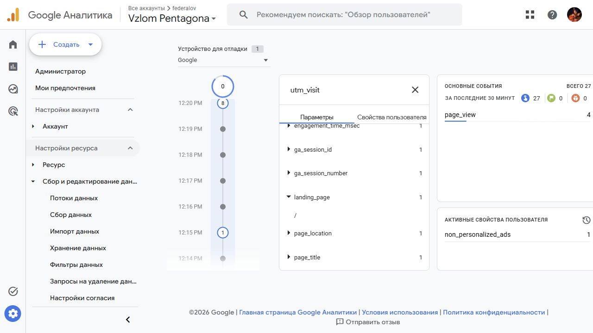
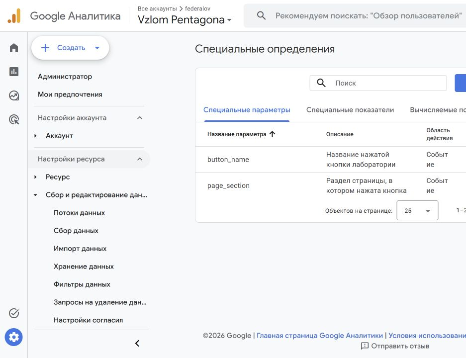
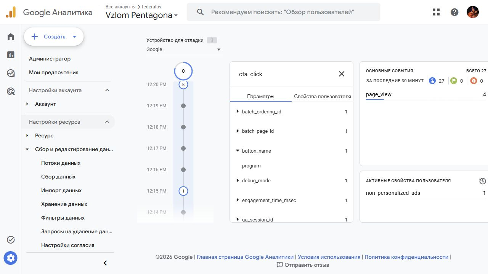
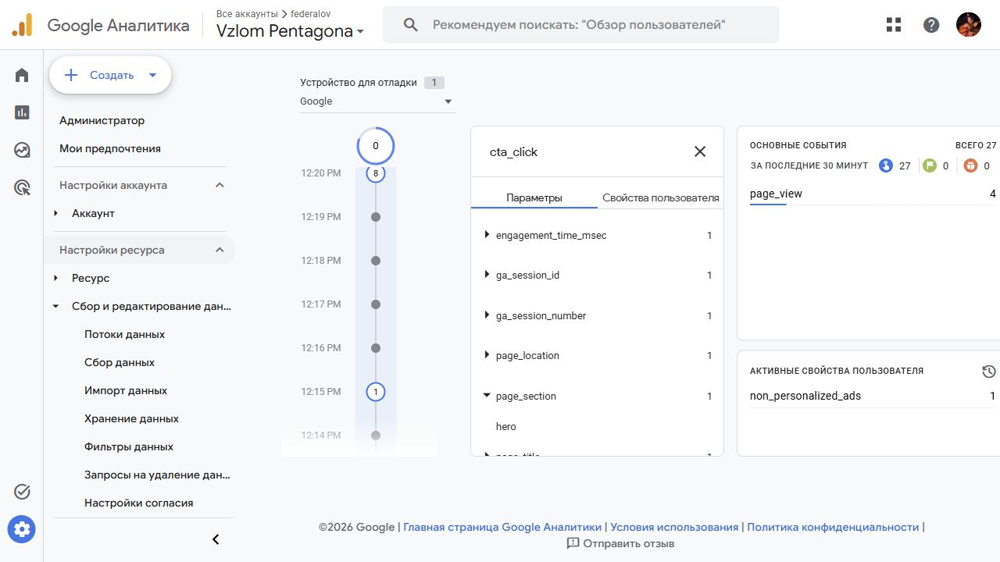
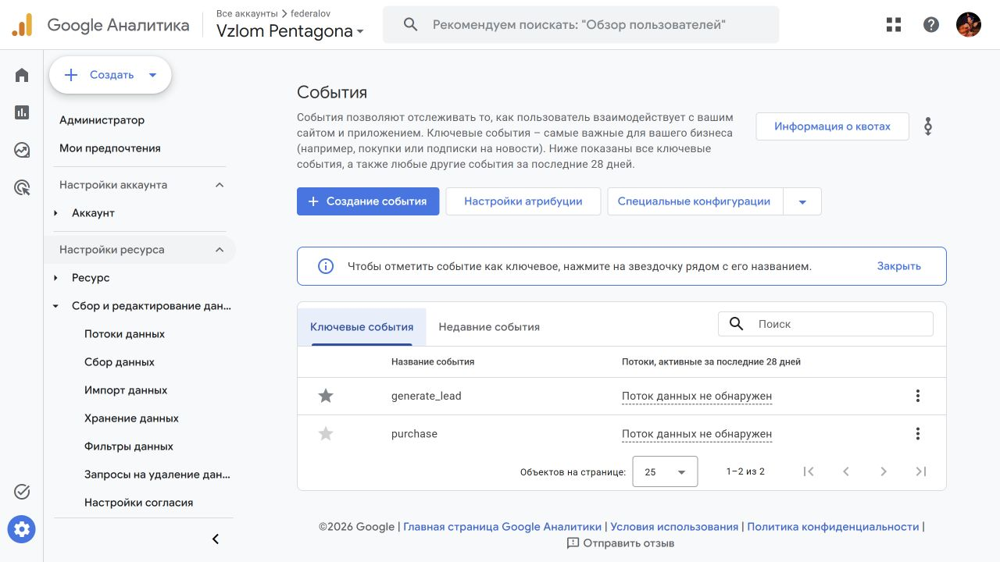

# Домашняя работа № 4 · Свои события и параметры

ОП.03 «Информационные технологии»

Автор: Паюсов Семён

Группа: РПО 2\25

Дата проверки: 21.10.2026

## Проект

Сайт: https://ga4-analytics-lab-six.vercel.app. Свой поток G-0L7H66CE9D. Основная реализация: b70113f; исправление включения debug_mode: ee86737.

metrics.js подключён один раз на index.html, about.html, contacts.html, guide.html. Код находится в [js/metrics.js](../js/metrics.js), обработчик формы — [js/script.js](../js/script.js).

| Событие | Что измеряет | Проверка |
|---|---|---|
| nav_click | Переход по меню | Получено в DebugView |
| utm_visit | Метки входа | Получено, параметры сверены |
| read_30s | 30 секунд видимой вкладки | Получено в DebugView |
| form_error | Ошибка обязательного поля формы | Пустая форма отклонена браузером; отдельный кадр события ещё нужен |
| scroll_75 | Достижение 75% прокрутки | Получено в DebugView |
| cta_click | Нажатие целевой кнопки | Получено, параметры сверены |

## Метки входа

Проверочная ссылка: https://ga4-analytics-lab-six.vercel.app/?debug_mode=true&utm_source=telegram&utm_medium=social&utm_campaign=lesson07

| Параметр | В ссылке / ожидается | В GA4 |
|---|---|---|
| utm_source | telegram | telegram |
| utm_medium | social | social |
| utm_campaign | lesson07 | lesson07 |
| landing_page | / | / |

## Кнопка и специальные параметры

Для cta_click получены button_name=program и page_section=hero. Оба параметра зарегистрированы в GA4 как параметры события.

## Вывод

Тесты подтверждают работу меню, меток входа, чтения и прокрутки. По тестовым визитам нельзя делать вывод, какой раздел предпочитают реальные посетители. Нужна отдельная проверка новых событий вне отладки и накопление данных в завершённом периоде. Имя и email в пользовательские события не передаются.
