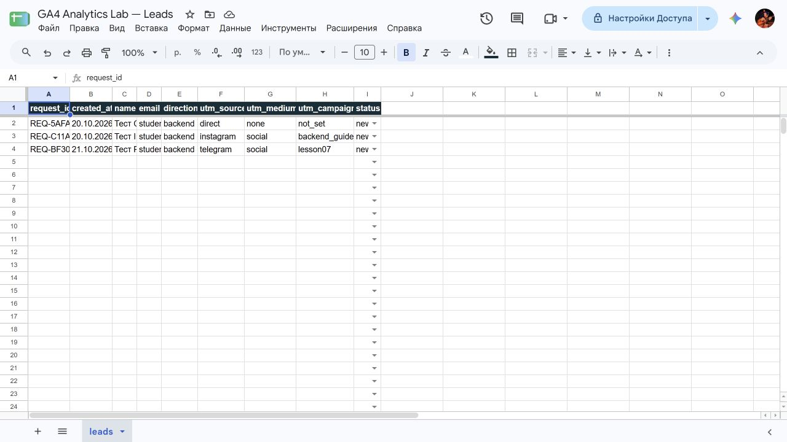
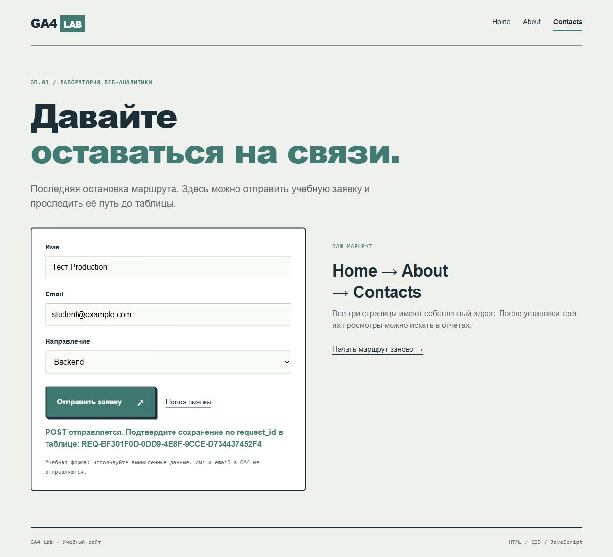

# Домашняя работа № 5 · Контролируемая таблица заявок

ОП.03 «Информационные технологии»

Автор: Паюсов Семён

Группа: РПО 2\25

Дата проверки: 21.10.2026

## Таблица и форма

Таблица: https://docs.google.com/spreadsheets/d/1VQ40uqpRfwoTX9QAmHVJKt_UVi6M051qoNm8NOQfdMs/edit

Лист leads содержит request_id, created_at, name, email, direction, utm_source, utm_medium, utm_campaign, status. Строка заголовков закреплена. Настроены четыре допустимых статуса new / in_progress / done / rejected, отклонение неверного значения, подсветка повторных ID и пропущенных обязательных полей.

Использован существующий опубликованный Apps Script Web App; добавлена функция setupLeadsSheet. Код: [Code.gs](../apps-script/Code.gs). Адрес приёмника стоит в action [contacts.html](../contacts.html), UTM и request_id — скрытые поля. Сайт: https://ga4-analytics-lab-six.vercel.app; Measurement ID: G-0L7H66CE9D; коммит формы b70113f.

## Подтверждённые заявки

| request_id | Источник / канал / кампания | Условия |
|---|---|---|
| REQ-5AFA429D-D226-41AF-9876-B58C4001E58D | direct / none / not_set | Локальная проверка 20.10 |
| REQ-C11AC31E-38C6-41D7-943E-A982409AA797 | instagram / social / backend_guide | Локальная проверка 20.10 |
| REQ-BF301F0D-0DD9-4E8F-9CCE-D734437452F4 | telegram / social / lesson07 | Production-проверка 21.10, 12:08:32 |

Production-путь: guide.html с метками → contacts.html → POST → новая строка leads со статусом new. Использованы тестовые данные student@example.com.

## Проверки и ограничения

Пустая обязательная форма не отправилась. Повторная отправка второго ID не создала строку. Дату и status=new задаёт сервер. Блокировка охватывает проверку request_id и запись.

generate_lead обозначает попытку отправки. Скрытый iframe не подтверждает запись; успешное сохранение проверяется по request_id в таблице. Поэтому количество событий может превышать число уникальных заявок.

Отдельные кадры временного дубля, отказа статуса finished и последовательности смены статуса ещё не сняты. Это не выдаётся за выполненную ручную проверку.
