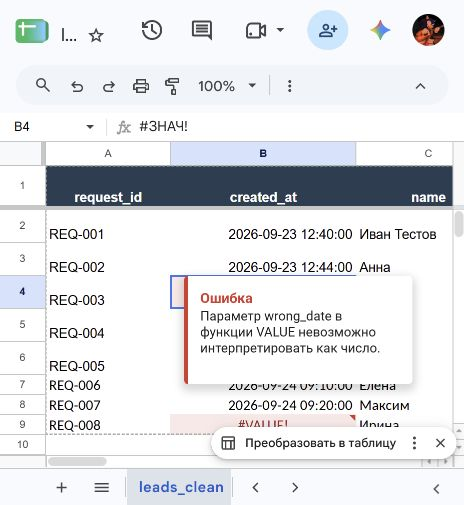
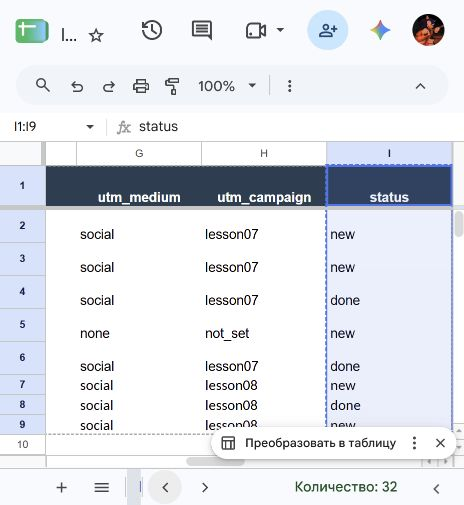
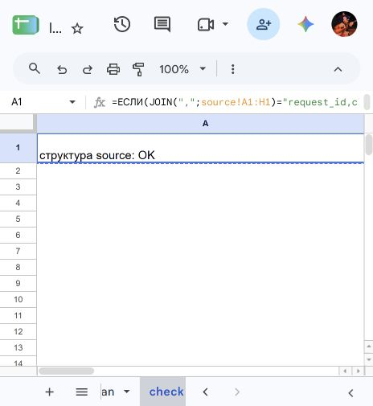

# Домашняя работа № 6 · Повторяемая очистка данных

ОП.03 «Информационные технологии»

Автор: Паюсов Семён

Группа: РПО 2\25

Дата проверки: 21.10.2026

## Исходники и таблица

Собственная таблица: https://docs.google.com/spreadsheets/d/1bOqphYUoC1VAnNCPeQj-LId39ZpJTQqDSH_CQ8pNR7s/edit

Листы source, leads_clean, check. Локаль Россия, часовой пояс Москва. Таблица заявок сайта сохранена отдельно. Учебные исходники курса лежат в [data](data); это учебные записи, а не трафик сайта.

## Правила

Вторая строка leads_clean содержит ARRAYFORMULA для каждого выходного поля, кроме utm_medium: этот столбец разворачивается из SPLIT вместе с utm_source. Убираются пробелы и непечатаемые символы; source_medium разделяется по |; источник, канал, кампания и статус приводятся к нижнему регистру; tg заменяется на telegram. Дата преобразуется ЗНАЧЕН, ошибки сохраняются видимыми.

## Проверка v1 → v2

Версия v1 дала пять очищенных строк; wrong_date у REQ-003 дал #VALUE!. Для v2 заменён только диапазон исходных данных source значениями из CSV через вставку таблицы. Формулы leads_clean не менялись. Получено восемь строк:

| Контроль | Результат |
|---|---|
| Число строк v1 / v2 | 5 / 8 |
| Ошибочные даты v2 | REQ-003, REQ-008 |
| REQ-006 | Елена / telegram / social / lesson08 / new |
| REQ-007 | Максим / vk / social / lesson08 / done |
| Уникальные статусы v2 | new, done |
| Проверка заголовков source | структура source: OK |

## Результат

[leads_clean.csv](leads_clean.csv) содержит реальные вычисленные значения диапазона leads_clean!A1:I9, скопированные из Google Таблицы и сериализованные в CSV UTF-8. Ошибки дат экспортированы как #VALUE!, они не заменены выдуманными датами.

[leads_cleaning.xlsx](leads_cleaning.xlsx) — экспорт всей итоговой Google Таблицы. Основной движок формул — Google Таблицы; совместимость ARRAYFORMULA с Excel отдельно не подтверждалась.

Не сняты окно исходного импорта и раскрытый фильтр статуса; выполненная замена v2 описана фактическим способом, без заявления об импорте через диалог.
