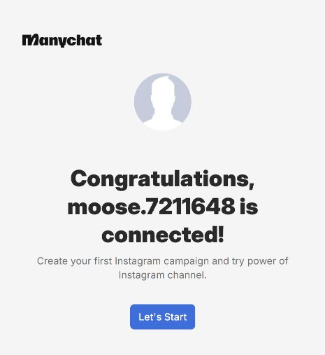
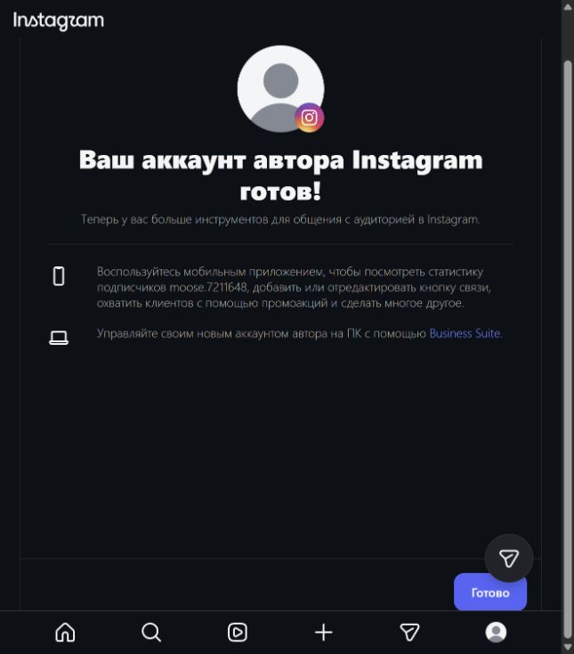
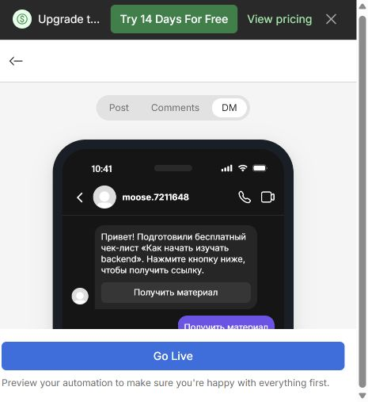
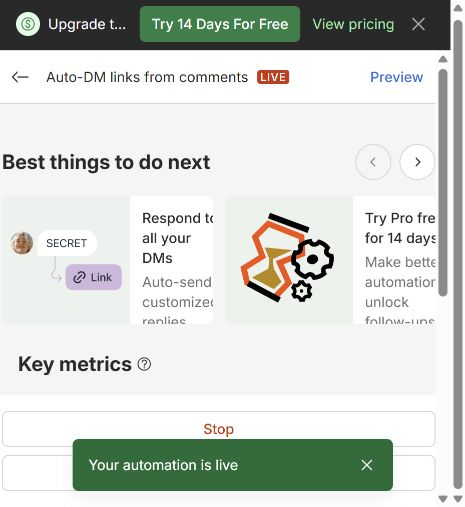

# Домашняя работа № 7 · Instagram → ManyChat → заявка

ОП.03 «Информационные технологии»

Автор: Паюсов Семён

Группа: РПО 2\25

Дата проверки: 21.10.2026

## Подготовленный маршрут

Материал: https://ga4-analytics-lab-six.vercel.app/guide.html?utm_source=instagram&utm_medium=social&utm_campaign=backend_guide&utm_content=reel01

Кнопка материала переносит четыре UTM к contacts.html. Приёмник сохраняет три основные метки. Тестовая строка instagram / social / backend_guide подтверждена ID REQ-C11AC31E-38C6-41D7-943E-A982409AA797 из локальной проверки 20.10.2026. Это тест веб-части, а не доказательство автоматического сообщения Instagram.

Сценарий и тексты: [docs/manychat.md](../docs/manychat.md).

## Текущее состояние

21.10.2026 профиль ManyChat создан через Google. Instagram moose.7211648 переведён в профессиональный аккаунт «Автор», категория «Образование», с разрешения владельца профиль стал общедоступным. Instagram показал подтверждение «Ваш аккаунт автора Instagram готов!».

Канал Instagram подключён к ManyChat. Подробности опубликованного сценария и границы теста приведены ниже.

## Подтверждение подключения

21.10.2026 Instagram moose.7211648 подключён к ManyChat. Интерфейс показал connected и 1 connected channel. Выбран бесплатный тариф Free без платной пробной подписки.

## Действующий сценарий

Публикация: https://www.instagram.com/moose.7211648/p/DexLesKiF9L/

Автоматизация: https://app.manychat.com/fb5811777/cms/easy-builder/content20240829181834_361233

Создана Quick Automation «Auto-DM links from comments». Конкретный пост выбран, ключевое слово ГАЙД. Три варианта публичного ответа на русском направляют в Direct. Первое сообщение предлагает кнопку «Получить материал»; следующее содержит кнопку «Открыть чек-лист» с четырьмя UTM, приведёнными выше. Запрос подписки, сбор email и платные дополнительные сообщения не включены.

21.10.2026 интерфейс подтвердил «Your automation is live», статус LIVE. Бесплатный тариф, Sends 0, Clicks 0, CTR 0% на момент фиксации.

Владелец сообщил, что второго аккаунта нет. Полный тест комментарий → фактический Direct → сайт → новая строка Sheets ещё не выполнен. Предпросмотр и статус LIVE подтверждают настройку, но не доставку сообщения. Веб-часть маршрута проверена отдельно. Для последующего теста нужен другой реальный аккаунт; комментарий владельца под собственным постом не заменяет проверку.

