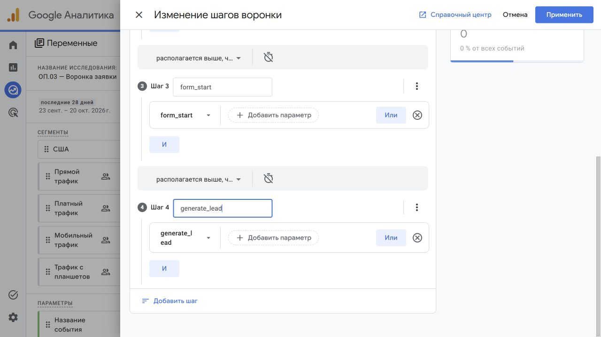
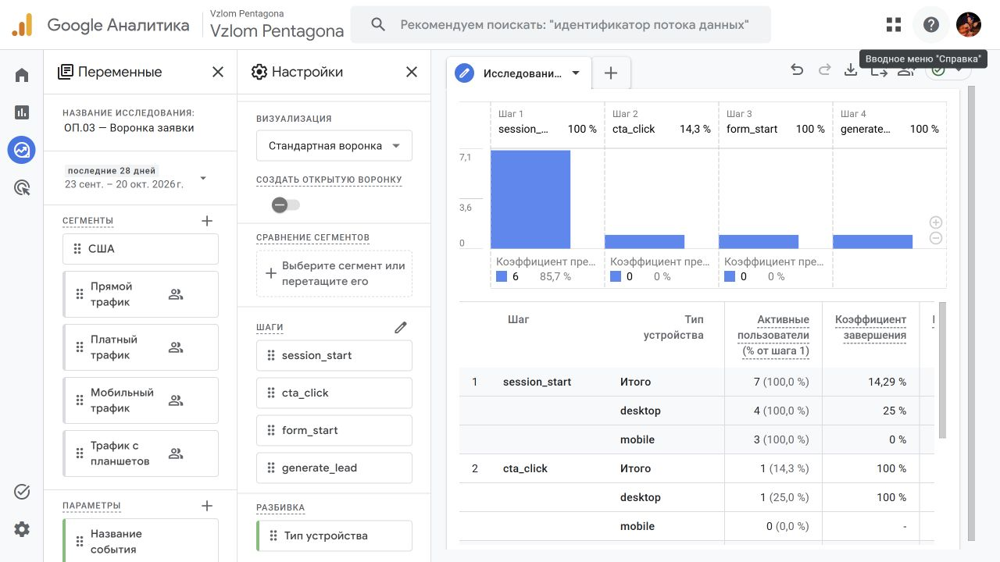
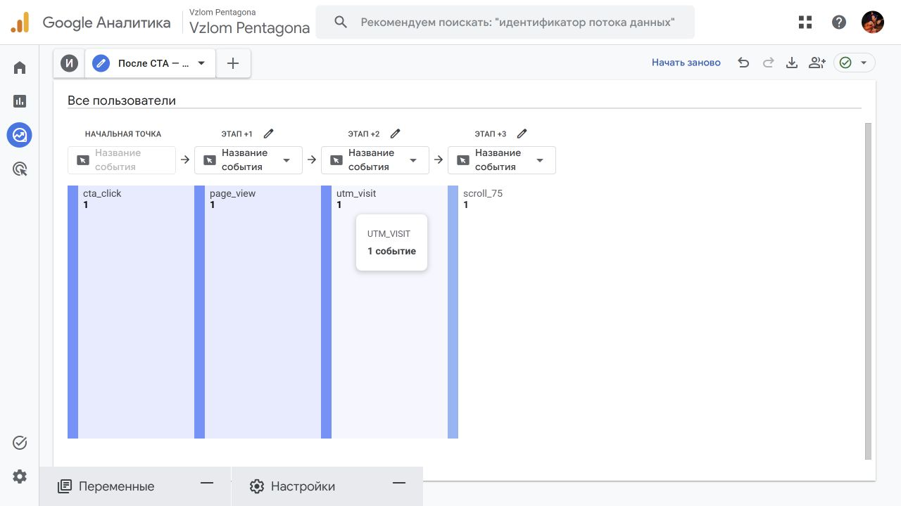

# Исследования GA4: воронка и путь

Автор: Паюсов Семён. Группа: РПО 2\25. Проверка: 21.10.2026.

Исследование собственного ресурса: https://analytics.google.com/analytics/web/#/analysis/a407359702p553374022/edit/i76jS01LQZKWyVBX1fLlBQ

Период: 23.09–20.10.2026. Данные учебные, выборка мала.

## Закрытая воронка

| Шаг | Активные пользователи | Переход на следующий шаг |
|---|---:|---:|
| session_start | 7 | 14,29% |
| cta_click | 1 | 100% |
| form_start | 1 | 100% |
| generate_lead | 1 | — |

События могут следовать с промежуточными действиями. Ограничение времени между шагами не задано; результат нельзя трактовать как конверсию одного сеанса. Первый шаг: 4 пользователя desktop и 3 mobile; последующие шаги — один desktop. Наибольшая потеря перед CTA: 6 пользователей, 85,71%. На этой выборке нельзя делать вывод о поведении реальной аудитории.

## Путь после CTA

В исследовании пути выбраны названия событий и показатель «Количество событий». Наблюдавшаяся цепочка: cta_click → page_view → utm_visit → scroll_75, по одному событию на показанных узлах. Это события, их нельзя напрямую сравнивать с активными пользователями воронки.

## Вывод и границы проверки

Следующая гипотеза — сделать основную кнопку заметнее и проверить её переходы на большей выборке. generate_lead фиксирует попытку отправки формы; сохранённая заявка подтверждается уникальным request_id в Google Sheets отдельно.

Обратный путь к generate_lead, Free form, сравнение сегментов и выгрузка из GA4 ещё не завершены. Этот отчёт содержит подтверждённую часть исследования; снимки не заменяют экспорт исходных данных.
