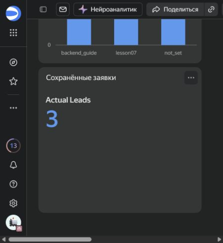
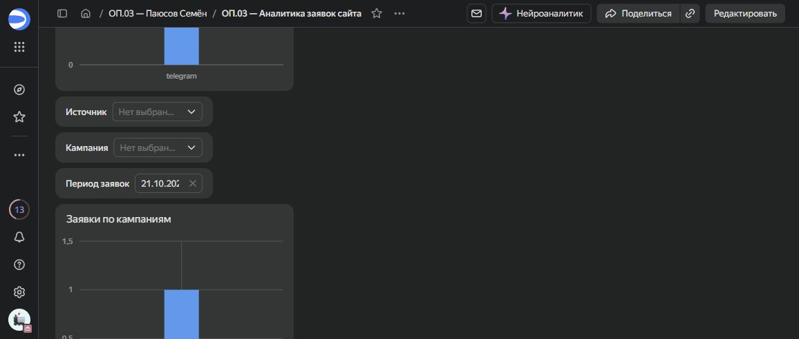
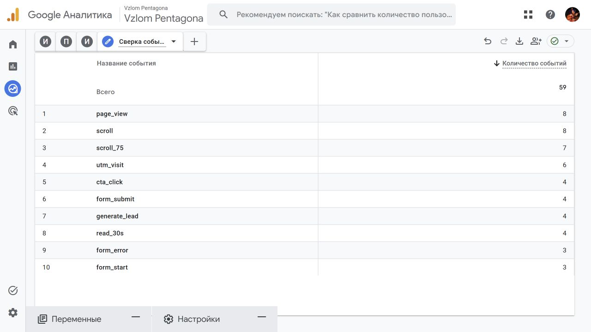

# DataLens: аналитика сохранённых заявок

Автор: Паюсов Семён. Группа: РПО 2\25. Проверка: 22.10.2026.

## Рабочие объекты

- [Дашборд](https://datalens.ru/4camr3wus37en-op-03-analitika-zayavok-sayta)
- [Подключение Google Sheets](https://datalens.ru/connections/ckchvu4bd65mv-zayavki-sayta-google-sheets)
- [Датасет без контактных полей](https://datalens.ru/datasets/081xxigge3tyj-zayavki-sayta-analitika-bez-kontaktov)
- [Заявки по источникам](https://datalens.ru/wizard/y64fvon9mlfyh-zayavki-po-istochnikam-actual-leads)
- [Заявки по кампаниям](https://datalens.ru/wizard/nvu6fi2iacls6-zayavki-po-kampaniyam-actual-leads)
- [Общий KPI](https://datalens.ru/wizard/5dco9t3qje9wo-vsego-sohranyonnyh-zayavok-actual-leads)

Источник — собственная таблица GA4 Analytics Lab — Leads, лист leads. Автообновление включено. DataLens используется в пробном периоде без платёжного аккаунта. Общедоступная публикация дашборда не включалась.

## Модель и показатели

Из датасета исключены name и email. Оставлены request_id, created_at (дата и время), direction, utm_source, utm_medium, utm_campaign, status. Исходная таблица сохраняет контакты; исключение из модели не ограничивает доступ владельца подключения к источнику.

Actual Leads = COUNTD([request_id]). Тип — целое число, агрегация — авто. Формула сохранена, показатель доступен в чартах. KPI считает уникальные сохранённые заявки. Два столбчатых графика разбивают этот показатель по источнику и кампании.

## Проверка фильтров

| Условие | Actual Leads | Результат |
|---|---:|---|
| Без фильтров | 3 | direct, instagram, telegram — по одной заявке |
| Источник instagram | 1 | Остаётся Instagram |
| Кампания backend_guide | 1 | Остаётся backend_guide |
| 20.10.2026 00:00:00 — 21.10.2026 23:59:59 | 3 | Все три строки периода |
| Только 21.10.2026 | 1 | Telegram / lesson07 |

Все три селектора используют тот же датасет, что графики и KPI. Значения проверены по исходным трём учебным строкам. Это тестовые заявки, а не реальные клиенты. Instagram-строка проверяет веб-часть и не подтверждает доставку ManyChat.

## Сверка с GA4

В исследовании GA4 добавлена свободная форма «Сверка событий — 20–21 октября»: строки — название события, значение — количество событий. В календаре подтверждён собственный диапазон 20–21.10.2026. Всего событий — 59; generate_lead — 4, form_submit — 4, form_start — 3, form_error — 3. Снимок содержит первые десять строк, а не полный список событий.

| Система | Что считается | Значение |
|---|---|---:|
| GA4 | События generate_lead, попытки отправки | 4 |
| Sheets / DataLens | Уникальные сохранённые request_id | 3 |
| Разница | Попытки минус сохранённые заявки | 1 |

Повторная отправка с прежним ID может создавать событие, но приёмник не записывает дубликат. Это возможное объяснение разницы; установить точную причину одного лишнего события по имеющимся данным нельзя. ID заявки не используется как ключ сопоставления в GA4. Даты таблицы используются как записанные в источнике; часовой пояс ресурса GA4 отдельно не подтверждён, поэтому сверка имеет это ограничение. Данные за 21 октября ещё могут обрабатываться.

Нативный CSV-экспорт GA4 был запрошен, но получение файла не подтвердилось. Данные выше прочитаны в интерфейсе и подтверждены снимком; они не выдаются за скачанную выгрузку.
